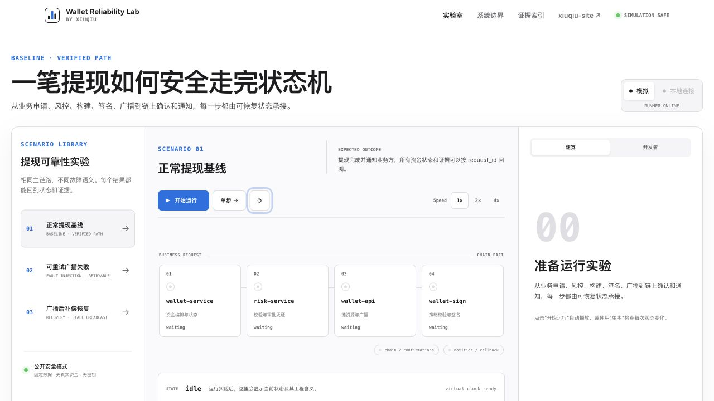

# Wallet Reliability Lab

> The interactive and explanation layer for wallet reliability. It stores no assets, handles no keys, and does not claim to be a production wallet.

[Live lab](https://wallet-reliability-lab.vercel.app) · [Engineering portfolio](https://xiuqiu-site.vercel.app) · [Wallet Domain Engine](https://github.com/qianqiu0404/web3-wallet-engineer-lab)

Wallet Reliability Lab turns withdrawal state transitions and recovery decisions into a deterministic workspace that can be paused, stepped through, replayed, and traced back to test evidence. The public deployment is simulation-only.



## Repository role

```text
xiuqiu-site                     portfolio, articles, and evidence index
        │
        ├── wallet-reliability-lab      interactive reliability experience
        │             │
        │             └── pinned Scenario Catalog contract
        │
        └── web3-wallet-engineer-lab    Go domain engine and fund invariants
```

This repository does not contain or depend on the private wallet services used for study. The optional local Runner accepts loopback targets only and never sends target addresses, credentials, or private logs to the browser.

The lab pins [Scenario Catalog v1.0.0](https://github.com/qianqiu0404/web3-wallet-engineer-lab/releases/tag/scenario-catalog-v1.0.0) by release, commit, and SHA-256 checksum. The three presentation scenarios map to the engine baseline, broadcast-unknown invariant, and canonical compensation invariant without copying private implementation details.

## Experiments

1. Normal withdrawal: `review_pending → create_unsign → signed → broadcasted → wallet_done → notified`
2. Retryable broadcast failure: keep `signed`, preserve balance state, and retry the same raw transaction
3. Stale broadcast compensation: cross the ten-minute virtual threshold, query the canonical chain fact, and recover to `wallet_done`

Routes:

- `/` — project positioning and experiment entry
- `/lab/:scenarioId` — interactive state-machine workspace
- `/architecture` — service boundaries and withdrawal call flow
- `/evidence` — sanitized test and engineering evidence

## Run locally

The browser engine is deterministic and works without the Go process:

```bash
npm ci
npm run dev
```

Run the local API/SSE Runner in a second terminal:

```bash
npm run runner
```

Vite proxies `/api` to `127.0.0.1:8787`. When reachable, the frontend creates a Runner run, sends start/pause/step/reset actions, and consumes ordered SSE events. If the Runner is absent, the public-safe browser simulation remains available.

## Verification

```bash
npm test
npm run build
npm run check:public
npm run check:catalog
npm run vet:runner
npm run test:runner:race
```

## Boundaries

- no real blockchain RPC, private key, signer, or asset;
- no production ledger, multi-instance scheduler, or custody operation;
- public Vercel builds never enable connected mode;
- test names and logs are sanitized summaries, not private repository output;
- the local connected adapter is a development boundary, not a production integration claim.

## License

MIT © xiuqiu
